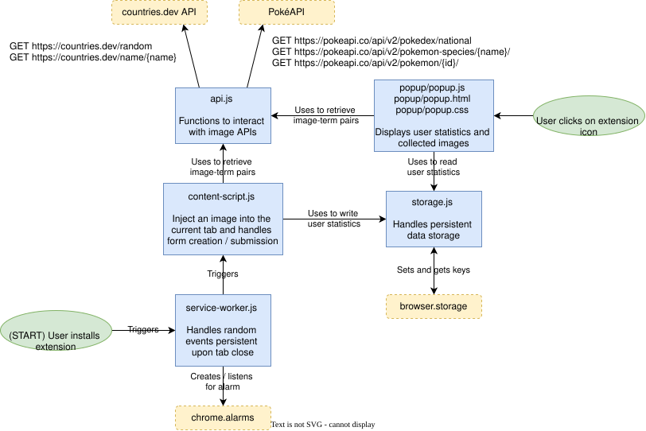
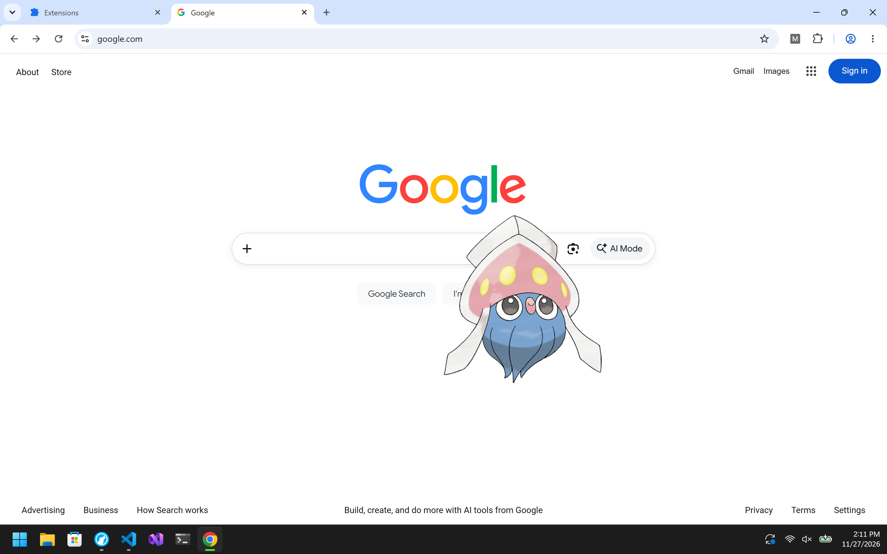
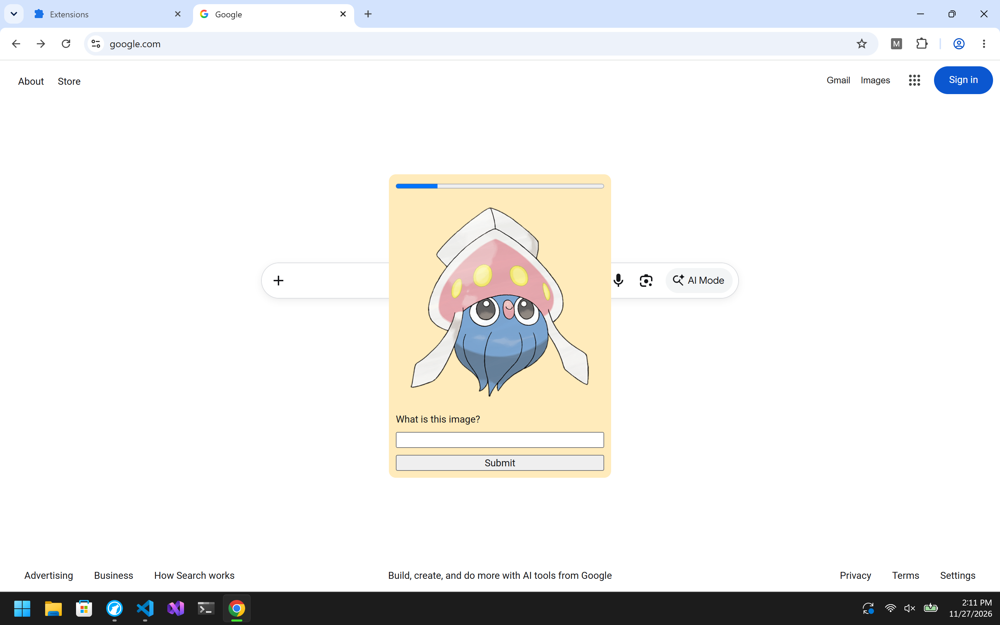

# Memorize 'Em All

Chrome extension which helps you memorize image-term pairs!

## The Problem

I've wasted hundreds of hours memorizing things--tree species, Pokemon names, flags of countries--which I then forget. Most memorization tools require the user to actively decide to periodically use them, so it is easy stop without motivation.

## How It Works

This extension takes a dataset of images and words corresponding with them (either sourced from an API or from the user). The extension will periodically display one of the images, and when the user clicks on them, they can type the matching word to "collect" the image. The extension will store and display user statistics.



## Tech Stack

- **Language:** JavaScript / HTML / CSS
- **External tools:**

  Chrome Extensions API (https://developer.chrome.com/docs/extensions/reference/api)
  
  REST Countries API (https://restcountries.com)
  
  PokéAPI (https://pokeapi.co/)

## Setup

### Step 1: Cloning the Repository
Prerequisite: [git](https://git-scm.com/) installed

Open a terminal and run
```
$ git clone git@github.com:JamesLNY/memorize-em-all.git
$ cd memorize-em-all
```
### Step 2: Creating `config.json`
Create a [Rest Countries API key](https://restcountries.com/)

#### Option 1
Prerequisite: [node.js](https://nodejs.org/en) installed

In the `src` directory, run
```
node .\build-config.mjs
```
and follow the prompts

#### Option 2
Create `config.json` in the `src` directory with
```
{
  "REST_COUNTRIES_API_KEY": <your_api_key>,
  "MIN_DELAY": 15,
  "MAX_DELAY": 20,
  "IMAGE_DURATION": 10,
  "FORM_DURATION": 5
}
```

### Step 3: Loading the Extension
Prerequisite: [Google Chrome](https://www.google.com/chrome/) installed

1. Go to `chrome://extensions` in a new tab
2. Toggle **Developer mode** in the upper-right corner
3. Clicked the **Load unpacked** button
4. Select the `src` directory

Taken from [this guide](https://developer.chrome.com/docs/extensions/get-started/tutorial/hello-world#load-unpacked) provided by Chrome

## Usage
1. Open a website (e.g. https://www.google.com/) in a new tab
2. Wait 15-20 seconds (dependent on the times set in `config.json`)
3. When a Pokémon appears, click on it



4. In the form that pops up, write a guess for name of the Pokémon



5. Press `enter` to submit the guess and see if you're correct
6. Press `enter` again to close the popup

## Roadmap

- [x] Pull images and corresponding terms from an API
- [x] Display images at random intervals
- [x] Open form when user clicks on an image
- [x] Display an indication if response matches
- [ ] Track and display images user has collected
- [ ] Store and include user-uploaded image-term pairs
- [ ] Setting to adjust time between pop ups
- [ ] Streaks, point system to buy power ups (e.g. streak freezes)

## Author

James Lei, [https://github.com/JamesLNY](https://github.com/JamesLNY)